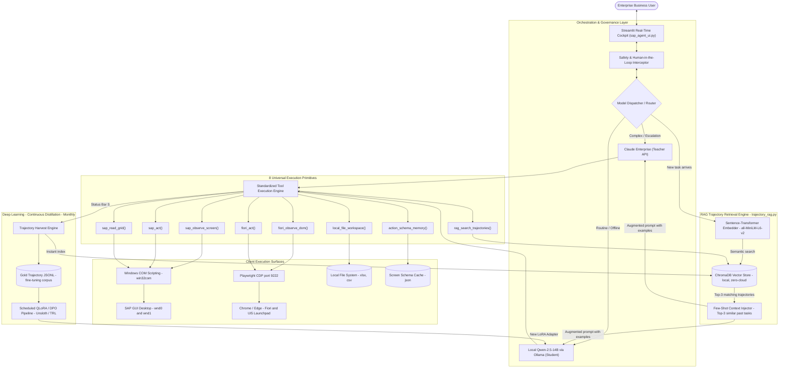

# Functional Specification Document (FSD)
## System: Autonomous SAP Hybrid Operator & Self-Improving Distillation Agent
**Document Version:** 2.0 *(Updated: RAG Trajectory Retrieval Engine integrated)*
**Target Build Engine:** Claude Enterprise / Python 3.11+ / Streamlit / win32com / Playwright / ChromaDB  
**Classification:** Enterprise Engineering Blueprint  

---

### 1. Executive Summary & Objective

#### 1.1 Objective
Design, build, and deploy a secure, autonomous, client-side SAP Agent that interacts with both **classic SAP GUI (Windows Desktop)** and **modern SAP Fiori / WebDynpro (Browser)**. The system eliminates manual transactional fatigue (data validation, mass creation, troubleshooting locked objects, migration simulations) without requiring backend SAP modifications (zero ABAP changes, zero BASIS RFC configurations, zero SAP BTP middleware fees).

#### 1.2 Three-Engine Hybrid Intelligence
The system operates under a **layered intelligence stack** — combining instant learning via RAG with deep long-term learning via fine-tuning:
1. **The Teacher (Claude Enterprise API)**: Orchestrates complex multi-turn reasoning, diagnoses obscure SAP errors, handles edge-case popups, and generates gold-standard ReAct execution trajectories.
2. **The Instant Learner (RAG — Trajectory Retrieval Engine)**: A local ChromaDB vector store that indexes every successful task trajectory. On each new request, it semantically searches past successful SAP executions and **injects the top 3 most similar as live few-shot examples** into the active model's prompt — making the local model smarter immediately, with zero retraining. This is the fastest improvement mechanism in the system.
3. **The Student (Local Qwen-2.5-14B / 32B via vLLM or Ollama)**: Runs locally on company hardware. It benefits from the RAG layer from Day 1, and is additionally fine-tuned (via periodic QLoRA/DPO runs on a monthly cadence) on verified successful trajectories, driving API consumption and cloud costs toward zero while keeping corporate data strictly on-premise.

---

### 2. High-Level Architecture



> [!NOTE]
> **Two-speed learning**: The RAG layer (ChromaDB) updates **instantly** after every successful task — no GPU required. The QLoRA pipeline bakes patterns into model weights on a **monthly** cadence. Together they cover both immediate and long-term performance improvement.

---

### 3. Detailed Functional Modules

The solution must be decomposed into **seven** distinct Python modules:

#### 3.1 Module 1: SAP GUI Automation Engine (`sap_gui_bridge.py`)
* **Purpose**: Native COM interface to connect with active SAP GUI sessions.
* **Functional Requirements**:
  1. **Session Hooking**: Attach to existing `SAPGUI` running instance via `win32com.client.GetObject("SAPGUI")`. Initialize `pythoncom.CoInitialize()` to guarantee thread safety inside multi-threaded Streamlit workers.
  2. **Screen Decomposition (`sap_observe_screen`)**:
     * Inspect active window (`wnd[0]` or modal dialog `wnd[1]`).
     * Extract Dynpro metadata: Program Name, Screen Number, Transaction Code, Window Title.
     * Recursively walk GUI component tree down to `usr/` container. Extract:
       * `GuiTextField`, `GuiCTextField`: ID, Label, Current Value, Changeable flag.
       * `GuiButton`, `GuiTab`: ID, Text, Tooltip.
       * `GuiGridView` (ALV), `GuiTableControl`: ID, row count, column count.
     * Extract Status Bar (`sbar`): Message text, Message Type (`S` = Success, `W` = Warning, `E` = Error, `A` = Abort, `I` = Info).
  3. **Screen Action (`sap_act`)**:
     * Command execution: Populate `okcd` field and trigger Enter (`/n...`, `/o...`, standard transaction codes).
     * Batch field updates: Inject values only into fields marked `Changeable == True`.
     * Virtual Key dispatching: Support Enter (`VKey 0`), Execute (`F8 / VKey 8`), Save (`Ctrl+S / VKey 11`), Back (`F3 / VKey 3`).
     * Tab Selection & Button Pressing: Native COM calls `.press()` and `.select()`.
  4. **High-Speed Grid Extraction (`sap_read_grid`)**:
     * For grids < 100 rows: Iterate rows using `grid.GetCellValue(row, col)`.
     * For large tables (> 100 rows): Trigger clipboard export (`grid.SelectAll()`, `grid.ClipboardCopy()`) and load into Pandas in-memory to prevent COM thread freeze.
  5. **Auto-Recovery on Warnings**:
     * If `status_bar.type == 'W'`, automatically issue `sendVKey(0)` (Enter) to acknowledge and proceed, unless the prompt explicitly forbids it.

#### 3.2 Module 2: SAP Fiori / Web Browser Engine (`fiori_playwright_bridge.py`)
* **Purpose**: Headed browser automation via Chrome DevTools Protocol (CDP) for SAP Fiori, Migration Cockpit (LTMC/Migrate Your Data), and WebDynpro.
* **Functional Requirements**:
  1. **CDP Attachment**: Connect to already-authenticated Chrome/Edge session on port `9222` (`--remote-debugging-port=9222 --user-data-dir=...`). Avoid credential/SSO re-authentication.
  2. **Active Tab Resolution**: Identify the active SAP Fiori Launchpad or LTMC tab, avoiding background utility tabs.
  3. **UI5 Element Extraction (`fiori_observe_dom`)**:
     * Run in-browser JavaScript extraction targeting both standard HTML elements and SAP UI5 specific controls (`.sapMBtn`, `.sapMInputBaseInner`, `.sapUiTable`, `[role="button"]`, `[role="tab"]`).
     * Extract text labels, input values, button states, and error alerts (`.sapMMessageView`, `.sapMListTblRow`).
  4. **Native Action Execution (`fiori_act`)**:
     * Fill inputs, click buttons, select dropdowns, and upload local files (`set_input_files`).
     * Provide wait-for-idle synchronization to allow SAP UI5 OData calls to resolve before sampling the DOM.

#### 3.3 Module 3: Schema Cacher & Memory (`sap_memory.py`)
* **Purpose**: Minimize token payload by preventing repeated re-parsing of known static SAP screens.
* **Functional Requirements**:
  1. Save discovered screen schemas indexed by `Program_Dynpro` (e.g., `SAPMV45A_4001`) into a local JSON store.
  2. When a known screen is revisited, load cached field IDs directly and only transmit dynamic state changes (values and error messages) to the LLM.

#### 3.4 Module 4: Agent Core & ReAct Loop (`universal_sap_agent.py`)
* **Purpose**: Orchestrate the ReAct (Reason $\rightarrow$ Act $\rightarrow$ Observe) trajectory loop.
* **Functional Requirements**:
  1. **Unified Tool Registry**: Expose identical tool definitions (JSON schemas) whether executing against Claude Enterprise, Gemini, or local models.
  2. **Step Budget & Loop Prevention**:
     * Cap agent execution at a configurable maximum number of turns (default: 25 turns).
     * Loop detection: If the identical tool and argument set is called 3 consecutive times with identical status bar output, pause and request human intervention.
  3. **Transaction Rollback Harness**:
     * If an unhandled exception or agent error occurs midway through a transaction, automatically execute `/n` in the active SAP session to release database locks (`SM12`).
  4. **Safety & Governance Filter**:
     * Whitelist allowed commands vs. restricted commands.
     * Hard-stop gate: Any action attempting to execute `/nSE14`, database deletion routines, or `SAVE` in production systems must pause the agent and trigger an explicit UI approval modal.

#### 3.5 Module 5: Trajectory Harvester & Distillation Pipeline (`distillation_pipeline.py`)
* **Purpose**: Harvest Claude Enterprise execution trajectories, curate training sets, and fine-tune local models.
* **Functional Requirements**:
  1. **Telemetry Logger**: Intercept all ReAct steps and serialize them into standard OpenAI/ShareGPT-compatible multi-turn conversation JSONL records:
     * `system`: System instructions & tool schemas.
     * `user`: Goal prompt.
     * `assistant`: Thought process + tool call request.
     * `tool`: Observation from SAP GUI / Fiori.
  2. **Quality Gate Filtering**:
     * Flag trajectory as **Candidate Gold** ONLY IF:
       * Final SAP status bar returns `S` (Success).
       * OR expected target file / report was successfully written.
       * AND zero manual user aborts occurred.
  3. **DPO Pair Generator**:
     * When the local model fails and Claude resolves the issue, pair the local model's failed tool-call as `rejected` and Claude's successful tool-call as `chosen`.
  4. **Fine-Tuning Harness**:
     * Pre-configured script using `unsloth` or Hugging Face `TRL` (`SFTTrainer` / `DPOTrainer`) targeting `Qwen/Qwen2.5-14B-Instruct` using 4-bit QLoRA.
     * Output format: Quantized GGUF or standard Hugging Face LoRA adapter, auto-copied into the local Ollama/vLLM model directory.
  5. **Dual Write After Success**:
     * Every verified gold trajectory is simultaneously written to both the `gold_trajectories.jsonl` (for fine-tuning) AND indexed into the **ChromaDB vector store** (for instant RAG retrieval). This ensures the two learning speeds are always in sync.

#### 3.6 Module 6: RAG Trajectory Retrieval Engine (`trajectory_rag.py`)

> [!IMPORTANT]
> This is the **fastest learning mechanism** in the system. It requires zero GPU, zero training time, and improves the local model's performance from the very first successful task logged.

* **Purpose**: Provide instant, zero-training-cost improvement to the local model by retrieving and injecting semantically similar past SAP task trajectories as few-shot examples at the start of every new prompt.
* **Core Concept**: Instead of asking the model to figure out how to do a task from scratch, the RAG engine shows it: *"Here is how you solved a nearly identical task last Tuesday — follow the same pattern."*
* **Technology Stack**: `chromadb` (local embedded vector DB, no server needed), `sentence-transformers` (all-MiniLM-L6-v2, runs on CPU).
* **Functional Requirements**:
  1. **Vector Store Initialization**:
     * Create a persistent local ChromaDB collection named `sap_trajectories` stored in `./chroma_store/`.
     * No external API calls. Runs 100% on-device.
  2. **Trajectory Indexing (`index_trajectory`)**:
     * Triggered automatically by the Trajectory Harvester whenever a gold-quality trajectory is confirmed (status bar `S`).
     * Embed the task's goal prompt using `all-MiniLM-L6-v2` (384-dimensional dense vector).
     * Store with metadata: `task_prompt`, `t_code`, `step_count`, `final_status`, `timestamp`, `serialized_steps_json`.
  3. **Semantic Retrieval (`search_similar_trajectories`)**:
     * Accept a new task prompt as input.
     * Return the **top 3 most semantically similar past trajectories** using cosine similarity.
     * Filter results to only return trajectories with `final_status == 'S'` (no failed examples injected).
  4. **Prompt Augmentation (`build_augmented_prompt`)**:
     * Format the retrieved trajectories into a structured few-shot block:
       ```
       --- PAST EXAMPLE 1 (Similarity: 94%) ---
       Task: Create PO in ME21N for vendor 500001, plant 1000
       Steps Taken:
         Step 1 → sap_act(ok_code="/nME21N")
         Step 2 → sap_act(field_updates={"EKKO-LIFNR": "500001", "EKKO-EKORG": "1000"}, vkey=0)
         Step 3 → sap_act(vkey=11)  [Save]
       SAP Confirmed: "PO 4500021432 created"
       --- END ---
       ```
     * Inject this block between the system prompt and the new user task.
  5. **Expose as Agent Tool (`rag_search_trajectories`)**:
     * Also expose retrieval as a callable tool so the agent can **proactively search its own memory** mid-task when it encounters an unfamiliar screen.
  6. **RAG Dashboard in UI**:
     * Display in the Streamlit cockpit: total indexed trajectories, top transaction code coverage (e.g., `VA01: 47 examples`, `ME21N: 31 examples`), and estimated RAG hit-rate percentage.

#### 3.7 Module 7: Streamlit Real-Time Cockpit (`sap_agent_ui.py`)
* **Purpose**: Clean, live enterprise control dashboard.
* **Functional Requirements**:
  1. **Model Switcher**: Toggle between Claude Enterprise, Gemini, and Local Model (Ollama/vLLM endpoint).
  2. **Connection Probes**: One-click ping test for SAP GUI COM attachment and Chrome CDP port `9222`.
  3. **Live Telemetry Cards**:
     * Active Program, Dynpro, and Transaction code.
     * Colored SAP Status Bar Badge (Green = `S`, Yellow = `W`, Red = `E`).
  4. **Step-by-Step UI Streaming**: Expandable accordion rendering each intermediate ReAct thought, tool argument JSON, and raw screen response in real-time.
  5. **Human-in-the-Loop Gateway**: Interactive buttons (`Approve`, `Edit Values`, `Abort`) displayed whenever a sensitive transaction is queued.
  6. **RAG Intelligence Dashboard**: Live panel showing indexed trajectory count per transaction, RAG hit rate per session, and similarity score of retrieved examples.

---

### 4. Technical Specifications & Tool Schemas

The model interacts with the local environment exclusively via these **8 JSON tool signatures**:


```json
[
  {
    "name": "sap_observe_screen",
    "description": "Inspects active SAP GUI window/popup. Returns screen Dynpro, editable field IDs, buttons, and status bar message.",
    "parameters": {
      "type": "object",
      "properties": {
        "force_refresh": {"type": "boolean", "description": "Bypass memory cache and re-crawl all components"}
      }
    }
  },
  {
    "name": "sap_act",
    "description": "Executes actions in SAP GUI: enters OkCodes, updates field values, clicks buttons, or presses virtual keys.",
    "parameters": {
      "type": "object",
      "properties": {
        "ok_code": {"type": "string", "description": "T-code or command to enter in OK-Code box, e.g. /nVA01, /nSE16N"},
        "field_updates_json": {"type": "string", "description": "JSON string mapping field IDs to values to enter, e.g. {\"wnd[0]/usr/ctxtVBAK-AUART\": \"OR\"}"},
        "click_id": {"type": "string", "description": "ID of GuiButton or GuiTab to press"},
        "vkey": {"type": "integer", "description": "Virtual Key: 0=Enter, 3=Back, 8=Execute/F8, 11=Save/Ctrl+S, 12=Cancel"}
      }
    }
  },
  {
    "name": "sap_read_grid",
    "description": "Reads data rows from an SAP ALV Grid or Table Control into structured JSON/dicts.",
    "parameters": {
      "type": "object",
      "properties": {
        "grid_id": {"type": "string", "description": "COM ID of GuiGridView or GuiTableControl (optional if only one exists)"},
        "max_rows": {"type": "integer", "description": "Maximum number of rows to retrieve (default: 50)"}
      }
    }
  },
  {
    "name": "fiori_observe_dom",
    "description": "Inspects active SAP Fiori / WebDynpro browser tab. Returns interactive UI5 inputs, buttons, and error alerts.",
    "parameters": {"type": "object", "properties": {}}
  },
  {
    "name": "fiori_act",
    "description": "Executes actions in SAP Fiori / WebDynpro browser tab.",
    "parameters": {
      "type": "object",
      "properties": {
        "action": {"type": "string", "enum": ["click", "fill", "upload_file", "press_key", "goto_url"]},
        "target": {"type": "string", "description": "CSS selector, element text, or file path (for uploads)"},
        "value": {"type": "string", "description": "Value to input (for fill or press_key)"}
      },
      "required": ["action", "target"]
    }
  },
  {
    "name": "local_file_workspace",
    "description": "Reads or writes local Excel (.xlsx), CSV, TXT, or JSON files to feed SAP or save SAP exports.",
    "parameters": {
      "type": "object",
      "properties": {
        "mode": {"type": "string", "enum": ["read_excel_or_csv", "write_csv", "write_excel", "read_text", "write_text"]},
        "file_path": {"type": "string", "description": "Absolute path to local file"},
        "content_json": {"type": "string", "description": "JSON payload to write (for write modes)"}
      },
      "required": ["mode", "file_path"]
    }
  },
  {
    "name": "action_schema_memory",
    "description": "Retrieves cached field definitions and known patterns for a specific SAP Dynpro / Program.",
    "parameters": {
      "type": "object",
      "properties": {
        "program_dynpro": {"type": "string", "description": "Key in format PROGRAM_DYNPRONUMBER, e.g. SAPLSE16N_0100"}
      },
      "required": ["program_dynpro"]
    }
  },
  {
    "name": "rag_search_trajectories",
    "description": "Searches the local ChromaDB vector store for the top-3 most semantically similar past successful SAP task trajectories. Use this proactively when approaching an unfamiliar screen or transaction to check if the agent has solved a similar task before.",
    "parameters": {
      "type": "object",
      "properties": {
        "query": {"type": "string", "description": "Natural language description of the current task or challenge, e.g. 'Create a sales order in VA01 for customer 1000 with material T-AS01'"},
        "top_k": {"type": "integer", "description": "Number of similar trajectories to retrieve (default: 3, max: 5)"},
        "filter_t_code": {"type": "string", "description": "Optional: Filter results to only trajectories involving a specific T-code, e.g. 'VA01'"}
      },
      "required": ["query"]
    }
  }
]
```

---

### 5. Implementation Roadmap & Deliverables

#### Phase 1: Core Automation Foundations (Days 1–3)
* Deliverable: Working [`sap_gui_bridge.py`](file:///C:/Users/vpbibikar/gemini/sap_gui_bridge.py) capable of connecting to open SAP GUI, walking `wnd[0]`, executing OkCodes, populating fields, and reading ALV grids via clipboard/COM.
* Deliverable: Working [`fiori_playwright_bridge.py`](file:///C:/Users/vpbibikar/gemini/fiori_playwright_bridge.py) connecting over CDP port 9222 and scraping UI5 buttons/inputs.

#### Phase 2: Agent ReAct Orchestration & Streamlit UI (Days 4–6)
* Deliverable: [`universal_sap_agent.py`](file:///C:/Users/vpbibikar/gemini/universal_sap_agent.py) binding the **8 tools** to the Claude Enterprise API (`anthropic` client).
* Deliverable: [`sap_agent_ui.py`](file:///C:/Users/vpbibikar/gemini/sap_agent_ui.py) featuring the Live SAP Telemetry Card, human-in-the-loop approval gate, and step-by-step chat streaming.

#### Phase 2b: RAG Instant Learning Engine (Day 6 — runs in parallel with Phase 2) ⚡
> [!TIP]
> Build this alongside Phase 2, not after it. The RAG engine starts delivering value from the very first task and requires no special infrastructure — just two pip packages (`chromadb`, `sentence-transformers`).
* Deliverable: [`trajectory_rag.py`](file:///C:/Users/vpbibikar/gemini/trajectory_rag.py) with `ChromaDB` vector store initialized at `./chroma_store/`, sentence-transformer embeddings, `index_trajectory()`, `search_similar_trajectories()`, and `build_augmented_prompt()`.
* Deliverable: RAG Intelligence Dashboard panel integrated into Streamlit cockpit showing indexed trajectory count and RAG hit rate.

#### Phase 3: Trajectory Harvesting & Distillation Pipeline (Days 7–9)
* Deliverable: [`distillation_pipeline.py`](file:///C:/Users/vpbibikar/gemini/distillation_pipeline.py) automatically capturing successful task logs into `gold_trajectories.jsonl` **AND** simultaneously calling `trajectory_rag.index_trajectory()` for instant RAG availability.
* Deliverable: QLoRA training script targeting `Qwen-2.5-14B-Instruct` with automated GGUF/Ollama export.

#### Phase 4: Production Hardening & Safety (Day 10)
* Unit test suite across standard transactions (`SE16N`, `VA01/VA03`, `ME21N/ME23N`, `BP`, `SM12`).
* Automated rollback handlers (`/n` on crash) and modal warning bypass (`VKey 0`).
* RAG retrieval accuracy validation: run 20 known tasks and verify top-1 retrieved example has similarity score > 80%.

---

### 6. Learning Speed Summary

| Method | When It Kicks In | Infrastructure Needed | Performance Gain |
| :--- | :--- | :--- | :--- |
| **RAG (Module 6)** | After **every single task** (instant) | CPU only, 2 pip packages | +30–45% success rate on known T-codes by Week 1 |
| **QLoRA Fine-Tuning (Module 5)** | Monthly batch run | GPU (RTX 4090 / A10G) | +15–25% additional lift over RAG baseline |
| **Combined (RAG + LoRA)** | RAG: instant / LoRA: monthly | Both | **~90–95% local model success by Month 3** |

---

### 7. Master Prompt Pack for Claude Enterprise

To construct this codebase using your Claude Enterprise account, submit the following structured prompts in sequence:

#### Prompt 1: Build the SAP GUI Bridge
> *"Generate `sap_gui_bridge.py` based on Section 3.1 of our FSD. It must use `win32com.client` and `pythoncom.CoInitialize()`. Implement `SAPGuiBridge` with methods: `inspect_active_screen(force_refresh=False)`, `execute_action(ok_code, field_updates, click_id, vkey)`, `read_alv_grid(grid_id, max_rows)`, and `auto_acknowledge_warning()`. Include thorough exception handling, modal popup detection on `wnd[1]`, and status bar extraction."*

#### Prompt 2: Build the Fiori Browser Bridge
> *"Generate `fiori_playwright_bridge.py` based on Section 3.2 of our FSD. Connect to an existing browser using Playwright CDP on `http://localhost:9222`. Implement methods: `inspect_fiori_dom()` and `execute_fiori_action(action, target, value)`. Focus on extracting SAP UI5 controls, handling file upload inputs, and waiting for UI5 OData network idle."*

#### Prompt 3: Build the Universal Agent & Claude Tool Binding
> *"Generate `universal_sap_agent.py` based on Section 3.4 and Section 4 of our FSD. Use the official `anthropic` SDK to bind Claude 3.5/3.7 Sonnet with our 8 JSON tool definitions (including `rag_search_trajectories`). Implement the ReAct loop with max turn budget (25), loop-detection logic, safe transaction rollback (`/n` on crash), and a callback mechanism for real-time UI streaming."*

#### Prompt 4: Build the Streamlit Cockpit UI
> *"Generate `sap_agent_ui.py` using Streamlit based on Section 3.7 of our FSD. Incorporate dual connection probe buttons for SAP GUI and Fiori CDP, live telemetry cards for program/screen/status bar, an expandable ReAct thought stream, a human approval gate for critical write actions, and a RAG Intelligence Dashboard panel showing indexed trajectory counts per T-code and session RAG hit rate."*

#### Prompt 5: Build the Trajectory Harvester & LoRA Distillation Pipeline
> *"Generate `distillation_pipeline.py` based on Section 3.5 of our FSD. Implement trajectory logging in ShareGPT/OpenAI tool format, quality gate validation (only status code 'S'), DPO pair generation, and an automated unsloth/TRL QLoRA training script for Qwen-2.5-14B. After confirming a gold trajectory, also call `trajectory_rag.index_trajectory()` to simultaneously add it to the ChromaDB vector store."*

#### Prompt 6: Build the RAG Trajectory Retrieval Engine ⚡ *(New)*
> *"Generate `trajectory_rag.py` based on Section 3.6 of our FSD. Use `chromadb` (local persistent mode, stored at `./chroma_store/`) and `sentence-transformers` (model: `all-MiniLM-L6-v2`). Implement: `TrajectoryRAG` class with methods `index_trajectory(task_prompt, t_code, steps_json, final_status)`, `search_similar_trajectories(query, top_k=3, filter_t_code=None)`, and `build_augmented_prompt(task_prompt)` which formats top-3 matches into a structured few-shot block ready for injection into an LLM system prompt. Only index and retrieve trajectories where `final_status == 'S'`. Include a `get_stats()` method returning a dict of trajectory counts per T-code for the Streamlit dashboard."*
